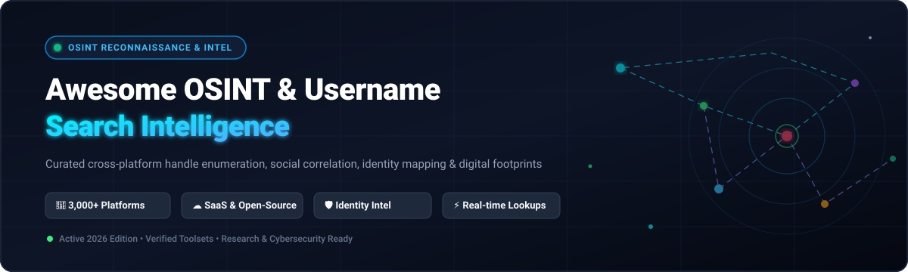

  

# 🔍 Awesome-Osint-Username-Search-Intelligence 🕵️‍♂️

  
  
  
  
  
  
  

## 🌐 Top OSINT & Username Search Intelligence Ecosystem

**Curated Directory of SaaS Solutions & Open-Source Repositories for Handle Enumeration, Identity Reconnaissance, and Digital Footprint Discovery** 📚✨  
*Keywords: OSINT, username search, username enumeration, handle lookup, digital footprinting, email OSINT, identity resolution, threat intelligence, cyber investigation.*

📅 **Last updated: November 2026**

---

This repository serves as an authoritative guide tracking premier **SaaS intelligence platforms** ☁️ and high-performance **open-source repositories** 💻 dedicated to **OSINT & Username Search Intelligence**. These utilities empower threat intelligence teams, private cyber investigators, fraud specialists, red/blue teams, and privacy researchers to conduct reverse username checks, correlate social media handles across thousands of web platforms, verify breach disclosures, and reconstruct digital identities. 🗺️🛡️

---

## 📑 Table of Contents

- [📊 Sector Overview & Market Dynamics](#-sector-overview--market-dynamics)
- [☁️ SaaS/Hosted Platforms](#️-saashosted-platforms)
- [💻 Open-Source GitHub Projects](#-open-source-github-projects)
- [🤝 How to Contribute](#-how-to-contribute)
- [💖 Support & Sponsorship](#-support--sponsorship)
- [📈 Star History](#-star-history)
- [⚠️ Disclaimer](#️-disclaimer)

---

## 📊 Sector Overview & Market Dynamics

The global Open Source Intelligence (OSINT) and digital identity investigation market is estimated at **$12.1B–$18.4B in 2025–2026** and projected to surge past **$43B–$60B by 2030** at an accelerated **15.6%–27% CAGR**. The sector remains **moderately fragmented**: while defense and enterprise risk consolidators (Palantir, Dataminr, Recorded Future, Maltego, Babel Street) anchor major government and corporate procurement contracts, specialized niche innovators and agile open-source projects dominate cross-platform username enumeration, social profile scraping, and real-time reverse lookup tooling.

---

## ☁️ SaaS/Hosted Platforms

The following SaaS platforms provide hosted infrastructure, managed API endpoints, or aggregated public record indexes for username and identity investigations. *Sorted by estimated company scale (annual revenue / valuation) in descending order:*

| Platform | Starting Price (Specific Tier) | Free Tier Limit / Free Trial Policy | Company Size (Est. Revenue / Valuation) | Primary Focus & Description |
| :--- | :--- | :--- | :--- | :--- |
| **[Spokeo](https://spokeo.com)** 📖 | **$19.95/month** (Standard 1-Month Plan) or **$14.95/month** (Billed quarterly at $44.85 for 100 searches/mo) | **7-day trial for $0.95–$1.95**; Free public directory search displays basic name/location but blurs full reports | **~$50M+ ARR** (Bootstrapped profitable consumer giant) | Cloud-based people-search aggregator consolidating public records, social handles, email records, and historical contact information. |
| **[BeenVerified](https://beenverified.com)** ✅ | **$36.89/month** (Standard 1-Month Plan, 100 reports/mo) or **$23.98/month** (3-Month plan at $71.94) | **7-day trial for $1.00–$5.00**; Free tier searches preview record counts but require active paid trial to unlock reports | **~$45M+ ARR** ($152M historical capital / Lifetime Value Co.) | Comprehensive consumer public-records and username/email lookup platform aggregating background data, social handles, and contact associations. |
| **[Pipl](https://pipl.com)** 👤 | **$298/month** (Pipl Search individual annual plan) / Pipl.ai entry at **$37/month** | **Free API preview trial upon request** (strictly 5 free test API queries or scheduled demo; no perpetual free consumer tier) | **~$15M–$17M ARR** ($19M VC funding) | Enterprise identity resolution and deep-web people search engine correlating usernames, emails, phone numbers, and global identity records. |
| **[Social Links](https://sociallinks.io)** 🔗 | **€3,000/year (~$270/month)** starting tier for commercial Maltego/standalone packages | **Free Community Edition (Social Links CE)**: free forever with basic transforms (Shodan, ZoomEye, SecurityTrails) on Maltego CE | **~$14M–$15M ARR** (Raised €10.2M; recent €2.6M round) | Enterprise OSINT suite and Maltego/i2 transforms extracting entity connections across 850+ social networks, messengers, and blockchains. |
| **[Social Catfish](https://socialcatfish.com)** 🎣 | **$36.00/month** (Standard Unlimited Social Search Plan) or $5.73 introductory trial | **3-day trial for $5.73**; Free preview generates initial scan animation and match confirmation but blurs profile details | **~$10M–$12M ARR** (Private niche leader) | Online identity verification and reverse investigation platform correlating usernames, email addresses, phone numbers, and profile avatars. |
| **[SkopeNow](https://skopenow.com)** 🔎 | **$99–$399/seat/month** (Median enterprise team contract: ~$23,760/year) | **7-day institutional trial** (Available to verified enterprise, law enforcement, or insurance teams; no consumer free tier) | **~$6.6M–$7.4M ARR** ($5.4M VC funding) | Enterprise automated intelligence platform for digital footprinting, social media link analysis, and court-ready investigative reporting. |
| **[Intelligence X (IntelX)](https://intelx.io)** 🌐 | **€2,500/year (~€208/month)** (Pro Tier) scaling to €9,500/year (Enterprise) | **Free forever plan: capped at 50 lookups/day** (web search interface only, no API access, restricted deep-archive data access) | **~$3M–$5M ARR** (Independent European archive) | Search engine and data archive indexing historical leaks, darknet pages, public records, emails, and usernames across billions of records. |
| **[UserSearch.org](https://usersearch.org)** 🕵️ | **$18.97/month** (Professional Plan with $10 monthly premium data credit refresh) | **Free forever tier**: unlimited basic social and forum username lookups on public modules (advanced deep OSINT requires credits) | **~$1M–$2M ARR** (Bootstrapped investigative tool) | Web-based username, email, and social profile lookup platform scanning hundreds of social networks, discussion forums, and dating platforms. |
| **[Epieos](https://epieos.com)** ⚡ | **€29.99/month (~$32/month)** for Osinter Plan (30 full-access multi-module requests/mo) | **Free forever member tier**: unlimited lookups on basic modules (Google, Skype, basic Email Checker) with watermarking/captchas | **Bootstrapped / ~$500K–$1M ARR** (High-growth indie OSINT) | Cloud OSINT platform specializing in non-intrusive email and phone-number-to-account discovery without alerting target accounts. |
| **[WhatsMyName Web](https://whatsmyname.app)** 🏷️ | **$0 (100% Free Community Project)** | **Free forever with no limit**: completely free web interface powered by the community dataset; no paywall or account required | **Open-source community funded** | Browser-accessible hosted interface powered by the open-source WhatsMyName dataset for instant cross-platform username enumeration. |

---

## 💻 Open-Source GitHub Projects

The leading open-source command-line utilities, web platforms, and libraries for username search intelligence, email-to-account discovery, and identity reconnaissance. *Sorted by GitHub Stars_Count in descending order:*

| Project | GitHub_Stars (Social Badge) | Primary Language / Stack | Core Capabilities & OSINT Focus |
| :--- | :---: | :---: | :--- |
| **[Sherlock](https://github.com/sherlock-project/sherlock)** 🔍 |  | Python | The benchmark CLI OSINT tool for hunting down accounts by username across 400+ social platforms simultaneously. |
| **[Maigret](https://github.com/soxoj/maigret)** 🕵️‍♀️ |  | Python | Powerful Sherlock fork that parses bio links, extracts rich metadata, crawls 3,000+ sites, and exports HTML/PDF/graph reports. |
| **[Web-Check](https://github.com/Lissy93/web-check)** 🌐 |  | TypeScript / Node | Comprehensive all-in-one OSINT web analysis dashboard displaying DNS, server locations, SSL, domain registration, and linked profiles. |
| **[SpiderFoot](https://github.com/smicallef/spiderfoot)** 🕷️ |  | Python | Modular OSINT reconnaissance framework pivoting usernames/emails into domains, breach data, PGP keys, and visual graph topologies. |
| **[Social-Analyzer](https://github.com/qeeqbox/social-analyzer)** 📊 |  | JavaScript / Python | API, CLI, and web application for discovering, analyzing, and scoring user profiles across 1,000+ platforms via string and OCR analysis. |
| **[GHunt](https://github.com/mxrch/GHunt)** 🎯 |  | Python | Investigative OSINT suite for extracting Google Account metadata, Gaia IDs, YouTube channels, and Google Maps review histories. |
| **[Osintgram](https://github.com/Datalux/Osintgram)** 📸 |  | Python | Dedicated Instagram OSINT interactive shell offering commands to analyze target handles, follower graphs, tagged photos, and user comments. |
| **[Holehe](https://github.com/megadose/holehe)** 📧 |  | Python | Checks if an email address is associated with accounts on 120+ platforms using password-recovery endpoints without alerting the target. |
| **[Blackbird](https://github.com/p1ngul1n0/blackbird)** 🦅 |  | Python / FastAPI | Extremely fast, asynchronous username enumeration tool querying 600+ platforms with built-in web dashboard and PDF report exports. |
| **[Mosint](https://github.com/alpkeskin/mosint)** 🛡️ |  | Go | Fast automated email & identity OSINT tool written in Go integrating breach checks, DNS records, and social account correlation. |
| **[Recon-ng](https://github.com/lanmaster53/recon-ng)** 🧭 |  | Python | Full-featured command-line web reconnaissance framework with modular architecture for aggregating contact and username leads. |
| **[h8mail](https://github.com/khast3x/h8mail)** 🔐 |  | Python | Email breach hunting and password correlation tool querying local breach compilations and public breach intelligence APIs. |
| **[Mr.Holmes](https://github.com/Lucksi/Mr.Holmes)** 🎩 |  | Python | Information gathering suite featuring both a CLI and local web GUI for auditing usernames, domain records, and phone numbers. |
| **[Social Mapper](https://github.com/greenwolf/social_mapper)** 👥 |  | Python | Intelligence tool that takes names and photos to correlate targets across social networks at scale using facial recognition. |
| **[Snoop](https://github.com/snooppr/snoop)** 🐕 |  | Python | Forensic username search engine supporting thousands of global and regional sites with census-style analytics and reporting. |
| **[WhatsMyName Dataset](https://github.com/WebBreacher/WhatsMyName)** 📇 |  | JSON / Python | The primary community-curated JSON dataset containing detection heuristics and URLs powering dozens of username enumeration tools. |
| **[Nexfil](https://github.com/thewhiteh4t/nexfil)** ⚡ |  | Python | Asynchronous Python utility designed to check username existence across 350+ websites in under 20 seconds with minimal false positives. |
| **[sn0int](https://github.com/kpcyrd/sn0int)** 🔬 |  | Rust | Semi-automatic OSINT package manager and reconnaissance crawler designed to map attack surfaces and identity targets cleanly in Rust. |
| **[Ignorant](https://github.com/megadose/ignorant)** 📱 |  | Python | Companion to Holehe that verifies if a given phone number is registered on major platforms (Snapchat, Instagram, Amazon, etc.). |
| **[Buster](https://github.com/sham00n/buster)** 🔎 |  | Python | OSINT tool to determine if an email or social account belongs to an individual by linking public accounts and profile identifiers. |

### 🌟 Additional Specialized Open-Source Libraries

- 🖼️ **[Search4faces / EagleEye](https://github.com)**: Reverse-image and avatar profile correlation pipelines.
- 🧅 **[Tor / Proxychains / TorBot](https://github.com)**: Route username requests through rotating proxies or Tor nodes to prevent IP bans.
- 📷 **[ExifTool](https://github.com)**: Extract embedded author handles, device serials, and GPS coordinates from uploaded media.
- 🐙 **Git Scrapers**: Mining commit histories on GitHub and GitLab for hidden author names and developer email addresses.

---

## 🤝 How to Contribute

Contributions are highly encouraged! To add or update an entry:

1. 🍴 Fork the repository.
2. ✍️ Add or modify entries in `README.md` following the tabular schema.
3. 📝 Ensure tool descriptions are factual, up to date, and include exact pricing/free tier data.
4. 🚀 Submit a Pull Request with a clear description of the addition.

---

## 💖 Support & Sponsorship

If this curated OSINT intelligence index helps your research, threat intelligence workflow, or investigative casework, please consider supporting the project:

- ⭐ **Star this repository** to help others discover it!
- 🍴 **Fork the project** and contribute new tools and validation heuristics.
- ☕ **Buy a coffee & sponsor**: You can sponsor ongoing maintenance and development via the [GitHub Sponsor Dashboard](https://github.com/sponsors/ishandutta2007).

Thank you to all community contributors, security researchers, and OSINT analysts keeping our investigations open and accurate! 🙌

---

## 📈 Star History

##  Star History
#`
`

---

## ⚠️ Disclaimer

- 📌 This repository is a **community-curated index** created strictly for legitimate cybersecurity research, educational purposes, threat analysis, and digital identity defense.
- ⚖️ Username enumeration tools rely on HTTP status codes and page-content heuristics that can produce false positives; always manually verify findings before attributing identities.
- 🛡️ Conduct all OSINT investigations in strict compliance with applicable privacy and data protection legislation (e.g., GDPR, CCPA, India's DPDP Act) and platform Terms of Service. Never use these tools for doxxing, stalking, or harassment.

---

  <b>Built with ❤️ for OSINT investigators, threat researchers, and privacy advocates worldwide.</b>

